<!-- Generated by scripts/render-profile.mjs. Edit that file, then run: node scripts/render-profile.mjs -->
<picture>
  <source media="(max-width: 700px) and (prefers-color-scheme: dark)" srcset="assets/board-v17-mobile-dark.svg">
  <source media="(max-width: 700px)" srcset="assets/board-v17-mobile-light.svg">
  <source media="(prefers-color-scheme: dark)" srcset="assets/board-v17-dark.svg">
  <source media="(prefers-color-scheme: light)" srcset="assets/board-v17-light.svg">
  
</picture>

Software developer in Istanbul. I build local-first software — macOS apps, terminal tools, and security workflows that keep data on the machine — plus the self-hosted infrastructure to run it on. Every project below is public and documented in its own repository.

## Selected work

### Application security

- **[byteback](https://github.com/batu3384/byteback)** — Windows forensic imaging and data recovery. C++17 engine covers NTFS, FAT/exFAT, and ext4 metadata recovery, signature carving, and virtual RAID — strictly read-only on source media.
- **[ironsentinel](https://github.com/batu3384/ironsentinel)** — Local-first AppSec command center. Guided scan missions normalize findings into one model and export SARIF, CSV, and HTML evidence — no hosted control plane.

### macOS

- **[riflo](https://github.com/batu3384/riflo)** — Personal remote desktop for macOS, iOS, and Windows. QUIC transport with end-to-end encryption, hardware HEVC/H.264 video, concurrent multi-session fan-out, zero-config LAN discovery — no cloud account or subscription.
- **[frostwall-beam](https://github.com/batu3384/frostwall-beam)** — End-to-end encrypted file transfer for LAN and internet. SPAKE2 pairing, XChaCha20-Poly1305 chunks, iroh NAT traversal, explicit receiver approval — no cloud account.
- **[falcon-dm](https://github.com/batu3384/falcon-dm)** — Tauri download manager with a Rust engine: multi-connection byte ranges, byte-exact resume after crashes, HLS segment assembly, and a paired Chrome extension. No cloud queue, no telemetry.
- **[ScreenTextGrab](https://github.com/batu3384/ScreenTextGrab)** — Notarized macOS menu-bar OCR app. Apple Vision runs on-device; modes for screen regions, subtitles, code, and tables, with automation through the `stg` CLI, URL scheme, and Shortcuts.

### Terminal & systems

- **[pi-gateway](https://github.com/batu3384/pi-gateway)** — Production DNS and home-lab gateway on Raspberry Pi. AdGuard and Unbound with DNS-over-TLS, Caddy reverse proxy, Grafana monitoring, CrowdSec, and encrypted 3-2-1 backups — deployed by a single make pipeline.
- **[calder](https://github.com/batu3384/calder)** — Electron workspace for parallel AI coding CLIs — Claude Code, Codex, Cursor, Antigravity. PTY-backed terminals, provider-aware launch and resume, session telemetry, and governance in one shell.
- **[sift](https://github.com/batu3384/sift)** — Review-first terminal cleaner for macOS and Windows. Typed Go core, dry-run by default, permission preflight, and audit history — destructive runs need explicit flags.

### Developer tooling

- **[agent-atlas](https://github.com/batu3384/agent-atlas)** — Capability layer that installs, health-checks, and routes open-web research tools for coding agents — ten channels, doctor diagnostics, end-to-end smoke tests.
- **[codebase-audit](https://github.com/batu3384/codebase-audit)** — Agent Skill for whole-repo architecture audits. Phased review with measured, path:line-cited findings and drift detection — no auto-fixes by design.

### Early stage

- **[duetto](https://github.com/batu3384/duetto)** — Chrome extension for Udemy: dual captions with Gemini translation, a term-lock glossary, timestamped notes, and precision playback controls.

Other public repositories

- **[hexloom](https://github.com/batu3384/hexloom)** — FastAPI text-transformation studio — eleven encode/decode/validate methods, batch workflows, live deployment with OpenAPI docs.
- **[jobcraft](https://github.com/batu3384/jobcraft)** — Local-first job-search workspace for Turkey — multi-portal search, fit scoring, LaTeX CV and cover-letter pipeline, application tracking.

Academic work

- **[vetvision](https://github.com/batu3384/vetvision)** — Desktop app for dog-breed recognition with PDF export and optional Gemini reports.
- **[fast-express-kds](https://github.com/batu3384/fast-express-kds)** — Cargo operations dashboard with branch analytics, personnel scoring, and forecasting.
- **[sisler-bulvari-cafe-system](https://github.com/batu3384/sisler-bulvari-cafe-system)** — Digital ordering prototype for Sisler Bulvarı Sanat Kafe.
- **[autonomous-line-following-robot](https://github.com/batu3384/autonomous-line-following-robot)** — Raspberry Pi line-following robot that stops on obstacles, with LED and buzzer alerts.

## Activity

2,081 contributions across 139 active days in the last 12 months · longest streak 23 days. Recent pushes: [frostwall-beam](https://github.com/batu3384/frostwall-beam) · [calder](https://github.com/batu3384/calder) · [byteback](https://github.com/batu3384/byteback) · [falcon-dm](https://github.com/batu3384/falcon-dm).

Board and this section are regenerated daily from the GitHub GraphQL API — last run 2026-11-27 13:15 UTC.

## Contact

[LinkedIn](https://www.linkedin.com/in/batu3384) · [Email](mailto:batu3384@gmail.com)
